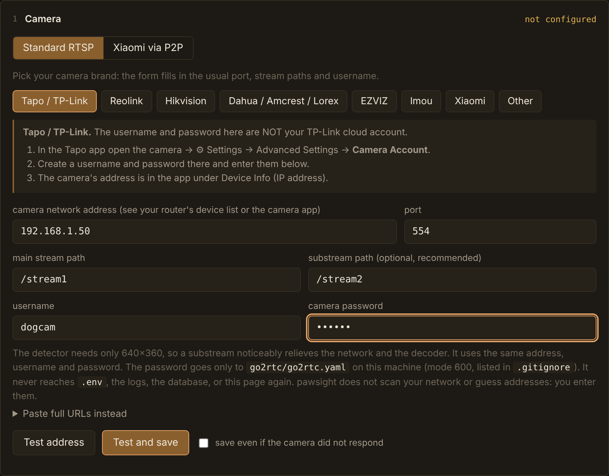
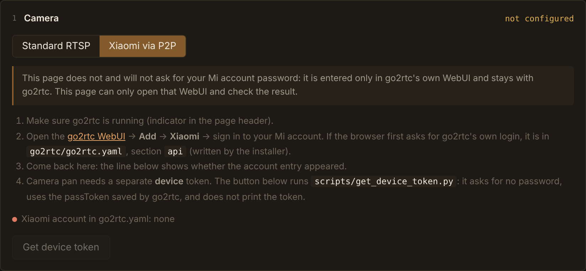
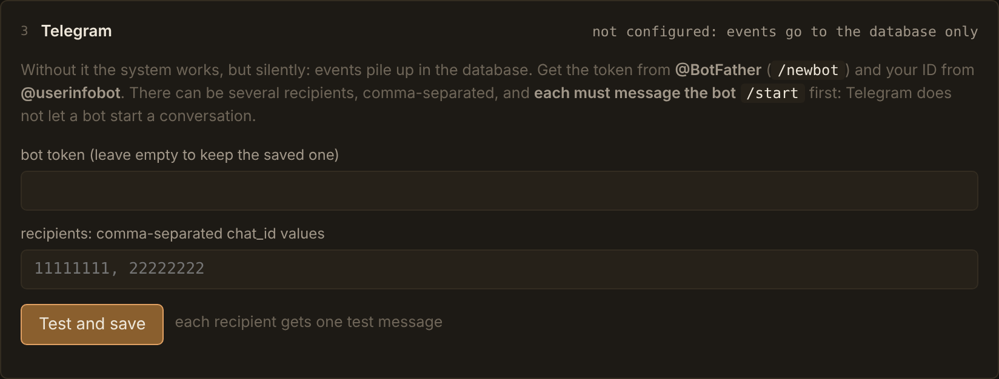
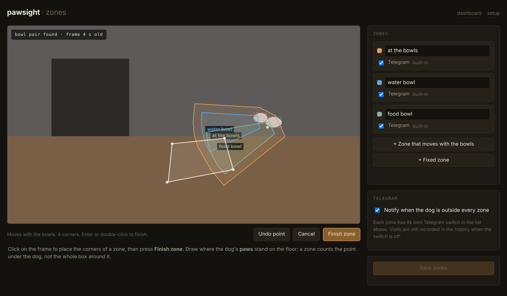
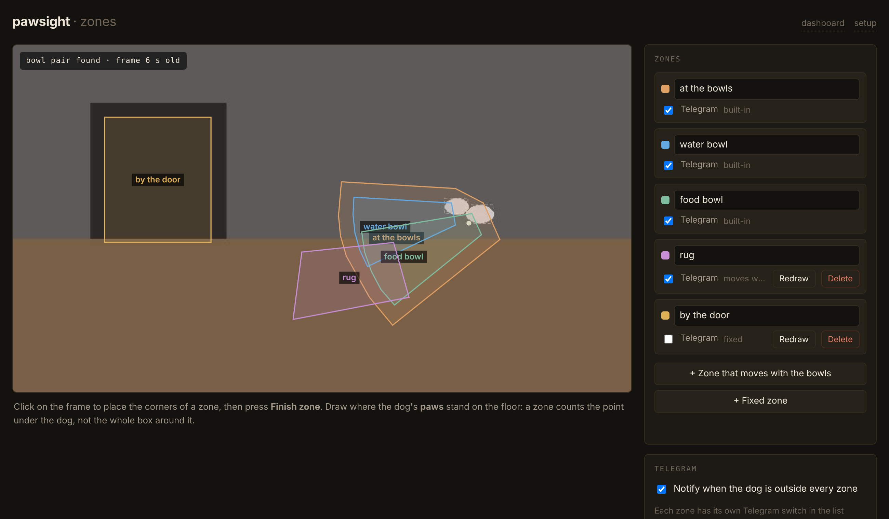

# Getting started: camera, Telegram and zones

This guide takes you from a fresh install to a dashboard that knows your camera,
sends you Telegram messages and counts visits to the places you care about.
Everything happens in the browser on the machine that runs pawsight. The pages
are only reachable from that machine (`127.0.0.1`).

The screenshots below were taken on a test frame, not a real room.

## 0. Install and start

```bash
git clone https://github.com/Belidor/pawsight.git && cd pawsight
./install.sh
./start.sh
```

Open `http://127.0.0.1:8099`. Until a camera is configured, this address shows
the setup page. Later you can always reach it at `http://127.0.0.1:8099/setup`
or through the **setup** link in the dashboard header.

## 1. Connect the camera

### A camera with RTSP (most brands)



1. **Pick your brand.** The form fills in the port, the stream paths and the
   usual username, and a note tells you where that brand keeps its RTSP switch:
   - **Tapo / TP-Link**: the username and password are a separate *Camera
     Account* that you create in the Tapo app (camera → Settings → Advanced
     Settings → Camera Account). Your TP-Link cloud login will not work.
   - **Reolink**: newer firmware ships with RTSP off. Turn it on in Settings →
     Network → Advanced → Server Settings (or Port Settings).
   - **EZVIZ**: the username is `admin`; the password is usually the
     verification code on the camera's sticker.
   - **Other**: look for "RTSP" in the manual. If the camera supports ONVIF, the
     free ONVIF Device Manager on a PC shows the exact stream URL.
2. **Enter the camera's address.** Your router's list of devices or the
   camera's own app shows it, for example `192.168.1.50`. pawsight never scans
   your network: you type the address.
3. **Keep the substream path.** The detector only needs 640×360, so a small
   second stream saves network and CPU. It uses the same address and login.
4. **Enter the username and password**, then press **Test address**. The page
   connects to the camera and names the problem if there is one: port closed,
   path not found, wrong login, not an RTSP port.
5. Press **Test and save.** The password goes only to `go2rtc/go2rtc.yaml` on
   this machine (mode 600, ignored by git) and is never shown again.

If you already have a full `rtsp://` URL, open **Paste full URLs instead** and
paste it there.

### A Xiaomi pan/tilt camera (P2P, no RTSP)



pawsight never asks for your Mi account password. You sign in inside go2rtc's
own page:

1. Open the go2rtc WebUI link on the tab → **Add** → **Xiaomi** and sign in.
2. Come back: the dot under the steps turns green when the account appears.
3. Press **Get device token**. Turning the camera needs it; the script uses the
   login go2rtc already saved and never prints the token.

## 2. Tell it which bowl holds water

Step 2 shows the live picture with both bowls outlined. Press **Water bowl is
the left one** or **the right one**. "Left" and "right" mean their order in the
frame, not in the room. Not sure yet? Skip it: visits are counted anyway, and
the camera's AI model tells drinking from eating on its own.

## 3. Telegram



1. In Telegram, message **@BotFather**, send `/newbot` and follow the prompts.
   It gives you a bot token.
2. Message **@userinfobot** to learn your numeric ID (chat_id).
3. **Send `/start` to your new bot.** Telegram does not let a bot write to you
   first.
4. Paste the token and the ID into step 3 and press **Test and save**. Each
   recipient gets one test message. For several people, separate the IDs with
   commas; each of them must send `/start` to the bot too.

Restart once after saving the camera and Telegram: `./stop.sh && ./start.sh`.

## 4. Draw your zones

Open **zones** in the dashboard header (`http://127.0.0.1:8099/zones`). The page
shows the latest frame the detector saw, the zones it knows and the bowls it
found.



1. Choose the kind of zone:
   - **Zone that moves with the bowls**: the zone is stored relative to the bowl
     pair, so it stays on the same spot of the floor when the camera turns.
     Both bowls must be in the frame while you draw it.
   - **Fixed zone**: plain frame coordinates. Use it only if your camera never
     turns.
2. Click on the frame to place the corners. Draw where the dog's **paws** stand
   on the floor: a zone checks the point under the dog, not the whole dog.
3. Press **Finish zone** (or Enter, or double-click). **Undo point** and
   Backspace remove the last corner; Escape cancels.
4. Name the zone in the list on the right.



### Choose what reaches Telegram

Every zone has a **Telegram** switch. Turn it off for places you only want in
the history, such as the sofa where the dog sleeps all day. The separate switch
**Notify when the dog is outside every zone** covers everything else. Events
are still recorded and shown on the dashboard when a switch is off.

Press **Save zones**. The detector and the notifications use the new zones at
once, no restart needed. The previous file is kept as `zones.yaml.bak`.

The three built-in zones (at the bowls, water bowl, food bowl) drive the visit
counting, so the editor lets you rename them and silence them but not move or
delete them.

## Next steps

- [DOCUMENTATION.md](../DOCUMENTATION.md): the dashboard, camera control and
  everything that can go wrong.
- [docs/FINETUNE.md](FINETUNE.md): teach the detector your own dog.
